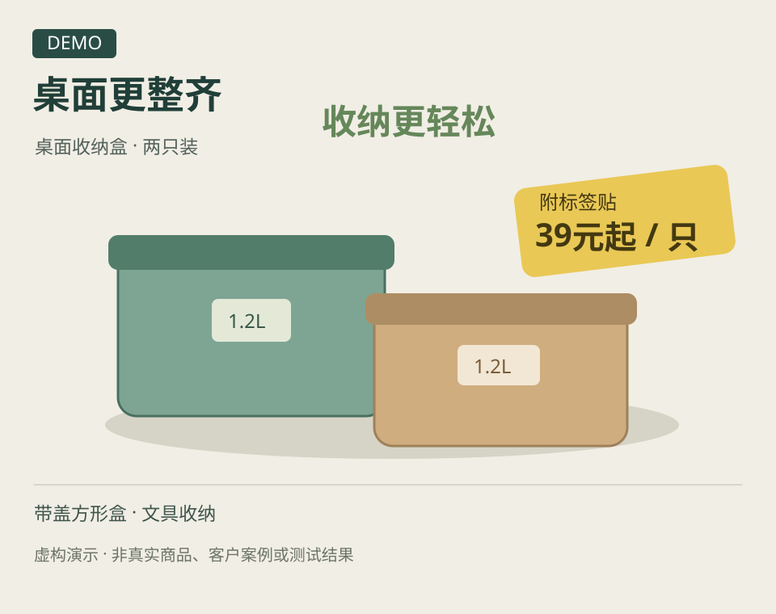

# 电商主图审查 · Ecommerce Creative Review

[English](README.en.md) · v0.1.0 · MIT

**把“这张图哪里不对”变成有依据、能动手的修改任务。**

给 AI 助手一张商品主图、产品说明和使用位置，获得：

- 图片里实际存在的问题，以及依据和不确定性。
- 少量优先修改动作，连接文案、商品展示和购买信息。
- 一张简版测试卡，说明下一版应该验证什么。

这是给支持 `SKILL.md` 的 AI 助手使用的技能包，适合电商运营、设计师和商家。识图需要宿主支持图片输入；本仓库的 Python 脚本只计算指标，不会自己识图或调用模型。



*上图是原创矢量演示，商品、价格和活动均为虚构，不是客户案例或效果证明。*

## 三步开始

### 1. 放入技能目录

```sh
git clone https://github.com/tttlc0507/ecommerce-creative-review.git
```

将 `skills/ecommerce-creative-review` 文件夹复制到你的宿主支持的技能目录。Codex 项目可使用 `.agents/skills/ecommerce-creative-review`；也可以直接让助手读取该文件夹中的 `SKILL.md`。

本次在 Codex 环境验证了格式和本地工具；其他宿主按各自文档配置，能力由其图片与文件支持决定。[Codex 官方技能说明](https://learn.chatgpt.com/docs/build-skills)

### 2. 上传图片并说明任务

```text
使用 $ecommerce-creative-review 审查这张商品主图。
商品：产品名称、规格、价格、已确认的特点。
位置：商品主图／搜索展示／推荐素材等；不确定也可以说。
目标：这次最想解决的问题。
请先给优先修改项，再给一张简版测试卡。不要生图。
```

有活动请补充适用规格和条件。商品详情文字、截图、链接都可作为资料；链接读不到时，可以用文字或截图继续。没有历史投放数据也能开始。

### 3. 修改后继续

上传新版并标记 `v2`，让助手检查哪些问题解决了、哪些还需验证。投放由你执行；拿到数据后，用版本对应的结果继续判断。

不想先准备商品？直接看[完整虚构示例](examples/demo-review.md)与[示例输入](examples/demo-product.md)。

## 一份报告包含什么

| 部分 | 应得到的内容 |
| --- | --- |
| 已知与缺口 | 图片所见、用户提供的事实、尚未确认的条件 |
| 优先动作 | 问题位置、观察、建议、依据及优先顺序 |
| 图文配合 | 文案要传达什么，商品与画面怎样支持它 |
| 简版测试卡 | 假设、对照、固定项、变化项、主要指标和缺口 |

审查会先确认使用位置；商品主图、详情首屏和广告素材不自动采用同一标准。它不会仅凭审美给图打分，也不会预测“改完必涨多少点击”。

## 可选：核对曝光、点击与成本

Python 3.9+，只用标准库，不需要安装依赖：

```sh
python3 scripts/metrics.py examples/demo-metrics.csv
```

支持 `creative_id,impressions,clicks,spend`，也支持常见中文表头。计算 CTR 和 CPC；不计算成交转化率、不自动宣布赢家。示例数字为虚构数据。

## 使用边界与资料处理

- 不生成图片、自动投放或抓取商家后台，不自带数据同步或收费服务。
- 未看到图片时，先处理已有文字并说明缺图；没有数据时只给待验证建议。
- 产品功效、优惠和销量需要来源，不能由 AI 补造。
- 仓库没有上传服务或遥测。你交给 AI 助手的图片与文件，由所选宿主和模型服务处理，请遵循其数据设置。
- GitHub Issue 是公开的。反馈请使用虚构或有权公开的内容，不上传客户图片、后台截图、订单、账号或密钥。

## 一起试用

做完一次审查后，欢迎通过[试用反馈](https://github.com/tttlc0507/ecommerce-creative-review/issues/new?template=trial-feedback.yml)告诉我们：建议能否执行、是否减少反复沟通、你是否愿意继续审查下一版。

[报告问题](https://github.com/tttlc0507/ecommerce-creative-review/issues/new?template=bug.yml) · [贡献说明](CONTRIBUTING.md)

欢迎分享具体使用体验。项目目前以小范围使用反馈改进，不承诺 CTR 或成交提升。

## 开发与检查

```sh
python3 -m unittest discover -s tests -v
python3 scripts/check_release.py
```

本仓库按 `release-manifest.json` 列出的文件发布。新增分发文件时需要显式更新清单。

## 许可

[MIT](LICENSE)，仅适用于本仓库中提供的文件。示例均为明确标注的虚构演示。
